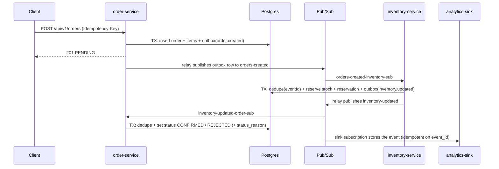
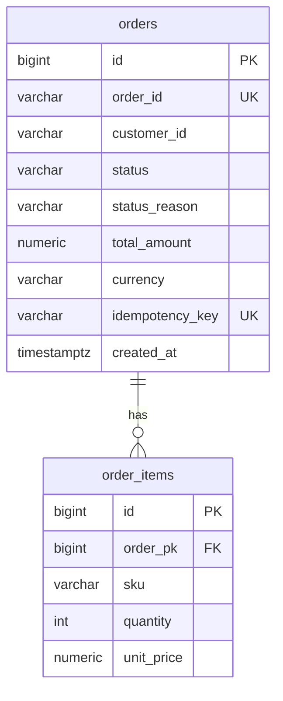
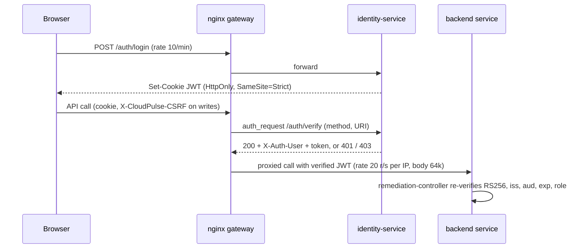

# CloudPulse AI - Low-Level Design

Scope: how each component is built (modules, APIs, data model, events, algorithms, state machines, deployment details). The architecture and trade-offs live in `HLD.md`, `messaging-design.md`, `anomaly-detection.md`, `self-healing.md`, `security-design.md`, `dr-strategy.md` and `cicd.md`.
Derived from the code as of Phase 15 (Flyway migrations, controllers, `application.yml`, nginx and Kubernetes manifests). Items not exercised against real GCP are marked **UNVERIFIED**.

## 1. System context and ports
| Component | Port | Tech | Persistence |
|---|---|---|---|
| dashboard (nginx + React SPA) | 8080 (svc), 8088 via port-forward | React/TypeScript, nginx gateway | none |
| identity-service | 8087 | Spring Boot 3.5, RS256 JWT | `auth_audit` |
| order-service | 8081 | Spring Boot, JPA/JdbcTemplate, Flyway | schema `orders` |
| inventory-service | 8082 | Spring Boot | schema `inventory` |
| operations-service | 8083 | Spring Boot (detection, incidents, twin) | schema `operations` |
| analytics-sink | 8084 | Spring Boot consumer, SQL store (BigQuery stand-in locally) | schema `analytics` |
| ai-incident-assistant | 8085 | Spring Boot, rule-based narrator + optional Vertex adapter **UNVERIFIED** | `answers` |
| remediation-controller | 8086 | Spring Boot + Kubernetes client | schema `remediation` |
| PostgreSQL 16 | 5432 | StatefulSet (Cloud SQL in GCP **UNVERIFIED**) | WAL archive to `/backup/wal` |
| Pub/Sub emulator | 8085 (in-cluster `pubsub-emulator`) | in-memory | none |

Common to every Java service: Java 21, Spring Boot 3.5.14 (security patch overrides), Actuator health/readiness probes, Flyway migrations, HikariCP pool 5 (`MINIMUM_IDLE=1`), RFC 7807 problem responses, no stack traces, non-root read-only container.

## 2. Event flow (sequence)

Failure behaviour: consumer exceptions nack, Pub/Sub redelivers with backoff (5 s to 300 s, at most 5 attempts), then the message goes to the topic's DLQ and is replayed with `scripts/dlq-replay.sh`. Duplicate delivery is harmless because every consumer records `event_id` in `processed_events` in the same transaction as its effect.

## 3. Event contracts
Topics: `orders-created`, `inventory-updated`, `payment-events`, `application-metrics`, `infrastructure-alerts`, `security-events`, `remediation-events`, each with a `<topic>-dlq`.
JSON Schemas (draft, versioned, in `architecture/event-schemas/`): `order.created.v1`, `inventory.updated.v1`, `metric.sample.v1`, `alert.raised.v1`, `remediation.event.v1`. Contract tests in each producer and consumer validate against them.

Envelope (all events):
| Field | Rule |
|---|---|
| `eventId` | string 1-64, unique; the dedupe key |
| `eventType` | constant per schema (`order.created`, ...) |
| `eventVersion` | integer constant (1); breaking change = new version and new schema file |
| `occurredAt` | RFC 3339 timestamp |
| `correlationId` | `^[A-Za-z0-9._-]{1,64}$`, propagated end to end |
| `source` | producing service |
| `data` | per-type payload |

`order.created.data`: `orderId` (`^ORD-[A-Z0-9]{12}$`), `customerId`, `items[] {sku, quantity>=1, unitPrice>0}`, `totalAmount>0`, `currency`.
Subscriptions: `orders-created-inventory-sub` (inventory), `inventory-updated-order-sub` (order), `application-metrics-ops-sub` (operations), plus the analytics sink subscriptions. Operations publishes `alert.raised` to `infrastructure-alerts`; the controller publishes `remediation.event` to `remediation-events`.

## 4. Data model (per service schema)
### 4.1 order-service

Also `outbox_events` (id UUID, topic, event_type, correlation_id, payload, created_at, published_at, attempts, last_error; partial index on unpublished rows) and `processed_events` (event_id PK). Constraints: `quantity > 0`, `unit_price > 0`, unique `order_id` and `idempotency_key` (a repeated key returns the original order).
Status values: PENDING, CONFIRMED, REJECTED (set from `inventory.updated`).

### 4.2 inventory-service
`stock_items(sku PK, description, available CHECK >= 0, updated_at)`, `reservations(order_id PK, status, reason, created_at)`, `processed_events`, `outbox_events` (same shape as above). Seed SKUs: `SKU-RED-1` (100), `SKU-BLUE-2` (50), `SKU-LOW-3` (3). The `CHECK (available >= 0)` is the last line of defence against overselling; reservation is a single transaction over all items of the order (all or nothing).

### 4.3 operations-service
- `metric_samples(id, event_id UNIQUE, service, metric, value, unit, synthetic, observed_at, ingested_at)`; index `(service, metric, observed_at DESC)`. `synthetic` is mandatory so test data is never mistaken for real telemetry.
- `incidents(id UUID, service, kind DETECTED|FORECAST, severity, risk_score, peak_risk, status OPEN|RESOLVED, opened_at, updated_at, resolved_at, clean_streak, summary, affected JSON, evidence JSON, recommendations JSON, synthetic)`; **partial unique index: at most one OPEN incident per service**.
- Digital twin: `twin_components(id, name, kind, description, deployment_status ACTIVE_LOCAL|PLANNED, criticality, parent_id, ui_x, ui_y)`, `twin_dependencies(from_id, to_id, relation, mode SYNC|ASYNC, description)`, `twin_transactions(id, name, business_impact, revenue_impacting)`, `twin_transaction_components`, `twin_recovery_steps(component_id, kind MESSAGE_RECOVERY|RECOVERY|MITIGATION, step_no, step_text)`. Seeded by migration V3.

### 4.4 remediation-controller
`remediations` (id, incident_id, service, action, status, deployment, namespace, from_replicas, to_replicas, floor_before, floor_restored_at, risk_score, incident_kind, rationale, guardrail_notes JSON, decided_by, decision_comment, decided_at, policy, executed_at, observed_replicas, recovered_at, time_to_recover_s, outcome, outcome_detail, synthetic, created_at, updated_at, expires_at; **UNIQUE (incident_id, action)** makes the proposer idempotent), `remediation_audit(id, remediation_id, at, actor, event, details)` with a trigger that rejects UPDATE and DELETE, and `controller_state(key, value)` holding `kill_switch`.

### 4.5 identity, assistant, analytics
- identity: `auth_audit(id, at, event, username, source_ip, detail)`, append-only trigger. Users and the signing key come from Kubernetes Secrets (bcrypt hashes; plaintext is refused at startup).
- assistant: `answers(id, asked_at, question<=500, intent, service, provider, confidence, answer, response_json)`, an audit of what was asked and the grounded response.
- analytics-sink: `order_events`, `inventory_events`, `metric_samples` (all keyed by `event_id` for idempotent ingest, JSONB payload, `occurred_at` versus `ingested_at` for pipeline latency).

## 5. REST APIs (as exposed through the gateway)
Gateway prefixes: `/orders-api/`, `/inventory-api/`, `/ops-api/`, `/assistant-api/`, `/remediation-api/`, `/auth/{login,logout,me}`.
| Service | Endpoints |
|---|---|
| order (`/api/v1/orders`) | `POST` create (idempotency key), `GET /{orderId}`, `GET` list |
| inventory (`/api/v1/inventory`) | `GET` list, `GET /{sku}`, `PUT /{sku}` (ADMIN) |
| operations (`/api/v1`) | `POST /telemetry/metrics`; `GET /metrics/latest`, `/metrics/series`, `/metrics/trend`, `/services/health`, `/overview`, `/detection/current`, `POST /detection/evaluate`, `GET /incidents`, `/incidents/{id}`; twin: `GET /api/v1/twin/graph`, `/impact` |
| analytics (`/api/v1/analytics`) | `/orders/trend`, `/inventory/outcomes`, `/pipeline/latency`, `/events/recent` |
| assistant (`/api/v1/assistant`) | `POST /ask`, `GET /questions`, `GET /history` |
| remediation (`/api/v1`) | `GET /remediations`, `/remediations/{id}`, `/remediations/{id}/audit`, `/remediation/status`, `/remediation/audit`; `POST /remediations/{id}/approve`, `/reject`, `/remediation/kill-switch` |
| identity (`/auth`) | `POST /login`, `/logout`; `GET /me`, `/verify` (gateway only), `/jwks` (internal only) |
Errors use RFC 7807 `application/problem+json` (400 validation, 401, 403, 404, 409 conflict/idempotent repeat, 429). Remediation approve of a non-PROPOSED item returns 409.

## 6. Detection algorithm (operations-service)
Runs every 10 s (`cloudpulse.detection.interval-ms`) per (service, metric) series. Defaults from `application.yml`:
| Parameter | Value | Purpose |
|---|---|---|
| baseline window / gap | 60 min / 180 s | learn "normal"; exclude the newest 3 minutes so an ongoing spike cannot teach the baseline |
| min baseline samples / span | 30 / 5 min | refuse to judge on too little history |
| current window | last 3 samples inside 90 s | "now" |
| z threshold | 3.0 | statistical significance |
| EWMA alpha / L | 0.3 / 3.0 | control-limit check (drift) |
| min relative deviation | 0.2 | practical significance: must also exceed baseline by 20% |
| forecast | at least 8 samples, 5 min window, target 95%, horizon 30 min, R squared at least 0.6 | linear extrapolation, always labelled LOW confidence |
| incident min risk | 40 | below this no incident is opened |
| resolve | 6 clean evaluations | hysteresis against flapping |
| stale | 120 s | ignore series that stopped reporting |
Steps: gather samples, compute baseline (mean, stdev), compute z and EWMA limits and the relative deviation, flag a finding only if z, EWMA and significance all agree; combine findings with `MetricRules` (metric weights) and `DependencyModel` (upstream/downstream propagation) into a risk score 0-100; `IncidentService` opens or updates the single OPEN incident per service (kind DETECTED or FORECAST), stores evidence and `RecommendationEngine` actions, publishes `alert.raised`, and resolves after the clean streak. Synthetic input yields synthetic incidents.

## 7. AI assistant pipeline
`POST /ask` -> intent classification (`engine`) -> evidence gathering from operations, analytics and the twin (`evidence`) -> deterministic narration (`narrate`) or the optional Vertex adapter **UNVERIFIED** -> **grounding validator** rejects any number, citation or command not present in the evidence -> response with confidence and cited evidence -> row in `answers`. The service is read-only: it has no credentials for, or network path to, the remediation controller.

## 8. Remediation state machine (controller)

```mermaid
stateDiagram-v2
  [*] --> PROPOSED
  PROPOSED --> APPROVED: operator approves (verified JWT) or explicit policy
  PROPOSED --> REJECTED
  PROPOSED --> EXPIRED: 15 min
  PROPOSED --> BLOCKED: guardrail (at max replicas, DB saturated)
  APPROVED --> EXECUTING: re-check kill switch, cooldown, hourly limit, bounds on FRESH state
  EXECUTING --> MONITORING: HPA minReplicas raised
  EXECUTING --> FAILED: Kubernetes API error
  MONITORING --> RECOVERED: incident resolved; floor restored
  MONITORING --> NOT_RECOVERED: timeout; floor stays, operator decides
```

Guard components: `ScalePlanner` (allow-list `order-service 2-6 step<=2`, `inventory-service 1-4 step<=2`, `operations-service 1-3 step<=1`; names validated before any API call), `AutoApprovalPolicy` (off by default; DETECTED only, risk at least 80, DB not saturated), cooldown 10 min per deployment, 3 actions per hour, kill switch in `controller_state`. The `k8s` package patches only `minReplicas` of three named HPAs (RBAC verb `patch` on those resources only). Every transition writes `remediation_audit` and a `remediation.event`. Approval identity is the verified JWT subject, never a request field.

## 9. Authentication and authorization (identity-service and gateway)

`PolicyEngine`: rules are (HTTP method, path regex, minimum role) from configuration, evaluated in order, **default deny**; roles are ordered VIEWER < OPERATOR < ADMIN. URIs containing `..`, `//`, `\`, `%2e`, `%2f`, `%5c`, `%00` or longer than 2000 characters are rejected before matching. Actuator is never routed. `/auth/jwks`, `/verify` and `/audit` are internal; the gateway returns 404 for `/auth/*` other than login, logout and me. Login protection: per-account lockout after 5 failures, separate per-IP threshold (30), identical responses for unknown user and wrong password, bcrypt checked against a dummy hash for unknown users. JWT: RS256 only (algorithm pinned), 30 min TTL, `kid` for rotation.

Policy table (first match wins, default deny; source `services/identity-service/src/main/resources/application.yml`):
| Method | Path (gateway) | Minimum role |
|---|---|---|
| GET | `/{ops,orders,inventory,assistant,remediation}-api/api/...` | VIEWER |
| POST | `/assistant-api/api/v1/assistant/ask` | VIEWER |
| POST | `/orders-api/api/v1/orders` | OPERATOR |
| POST | `/remediation-api/api/v1/remediations/{uuid}/(approve|reject)` | OPERATOR |
| POST | `/remediation-api/api/v1/remediation/kill-switch` | ADMIN |
| POST | `/ops-api/api/v1/telemetry/metrics` | ADMIN |
| PUT | `/inventory-api/api/v1/inventory/{sku}` | ADMIN |
The gateway rewrites `/ops-api/...` to the upstream path before proxying. The order API reads an optional `Idempotency-Key` header.

## 10. Kubernetes deployment details
- Layout: `kubernetes/base` (namespace with quota, RBAC, NetworkPolicies, workloads with HPA and PDB), `overlays/local` (Postgres StatefulSet with WAL archiving and a 2Gi backup PVC, Pub/Sub emulator, probe policies, replicas), `overlays/gke` (Artifact Registry images, Workload Identity annotations, Cloud SQL egress; **never applied**).
- Workload defaults: `runAsNonRoot`, read-only root filesystem, no privilege escalation, all capabilities dropped, seccomp RuntimeDefault, ServiceAccount tokens off (except the controller), resource requests and limits, readiness and liveness probes against Actuator.
- Replicas: order, inventory, identity and dashboard at 2 locally; HPAs per service (order max 6, inventory max 4, operations max 3).
- Availability: PodDisruptionBudgets; topology spread over `topology.kubernetes.io/zone` with `DoNotSchedule`, `nodeTaintsPolicy: Honor`, `matchLabelKeys: [pod-template-hash]`; tolerations for `unreachable` and `not-ready` with `tolerationSeconds: 30`.
- Network: default-deny ingress and egress; explicit allows (gateway to services, services to Postgres and Pub/Sub, controller to the API server only, DR probe to the gateway).
- Quotas: requests 8 CPU / 12 Gi; limits 40 CPU / 40 Gi (raised so replacement pods are not blocked by pods stuck Terminating on a dead node).
- Admission: ValidatingAdmissionPolicy denies missing limits, `:latest`, hostNetwork/hostPID/hostPath, privileged containers, and images outside the registry allow-list.
- Postgres: `max_connections=200`, `archive_mode=on`, `archive_timeout=30` (30 s upper bound on loss), pinned to one zone locally.

## 11. Configuration and secrets
Environment variables from ConfigMaps for non-secrets; secrets only via `secretKeyRef` (JWT signing key, bcrypt user hashes, DB password, approver token). Nothing secret in images, git or ConfigMaps (checked by `scripts/security-scan.sh secrets` and `k8s-security-verify.sh`). Demo credentials are generated by `scripts/k8s-up.sh` into `.run/` (git-ignored).

## 12. Resilience rules in code
| Concern | Mechanism |
|---|---|
| Lost or duplicate events | outbox + `processed_events` dedupe in the same transaction |
| Poison messages | max 5 deliveries then DLQ; replay script |
| DB connection exhaustion | pool 5 per pod, `max_connections=200`; budget = pods x 5 |
| Retry storms | exponential backoff 5 s to 300 s |
| Runaway automation | allow-list, bounds, cooldown, rate limit, kill switch, approval |
| Flapping alerts | one OPEN incident per service, 6 clean evaluations to resolve |
| Stale data | series older than 120 s ignored |

## 13. Test strategy (what exists)
Unit tests in all 7 Java modules (including Spring wiring tests, contract tests against the JSON Schemas, token-tampering tests for the controller); dashboard component tests (23); cluster suites `k8s-verify.sh` (24), `k8s-security-verify.sh` (45), `k8s-remediation-e2e.sh` (26); event-flow e2e scripts per phase; DR drills in `testing/dr/`; CI gates in `scripts/ci-local.sh`. How to run them: `doc/RUN-AND-VALIDATE.md`.

## 14. Known limitations (LLD level)
- Anomaly thresholds were tuned on synthetic data; real-traffic accuracy unknown.
- Only one executable remediation action exists (raise the HPA floor).
- Order status is eventually consistent (PENDING until the inventory event returns).
- In-cluster traffic is plaintext HTTP behind NetworkPolicies (risk R4).
- No token revocation (risk R1); single signing key.
- BigQuery, Vertex AI, real Pub/Sub and GKE paths are **UNVERIFIED**.
