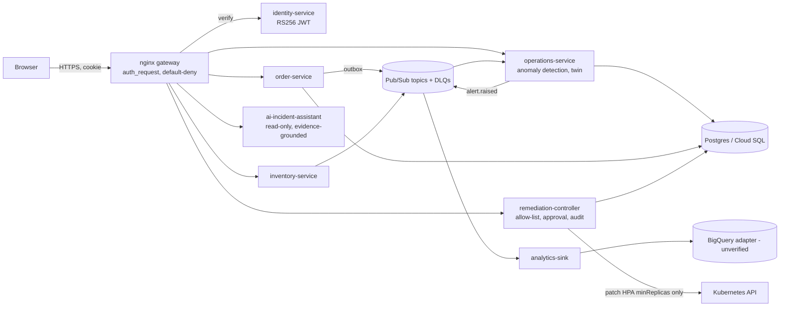

# System overview (Mermaid)

Local reality: kind cluster, Postgres StatefulSet, in-memory Pub/Sub emulator, synthetic telemetry. GCP resources are Terraform-authored, validated offline, never applied.
