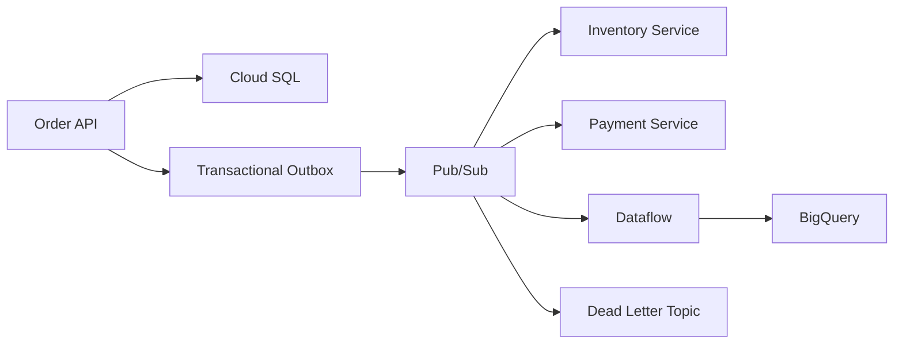
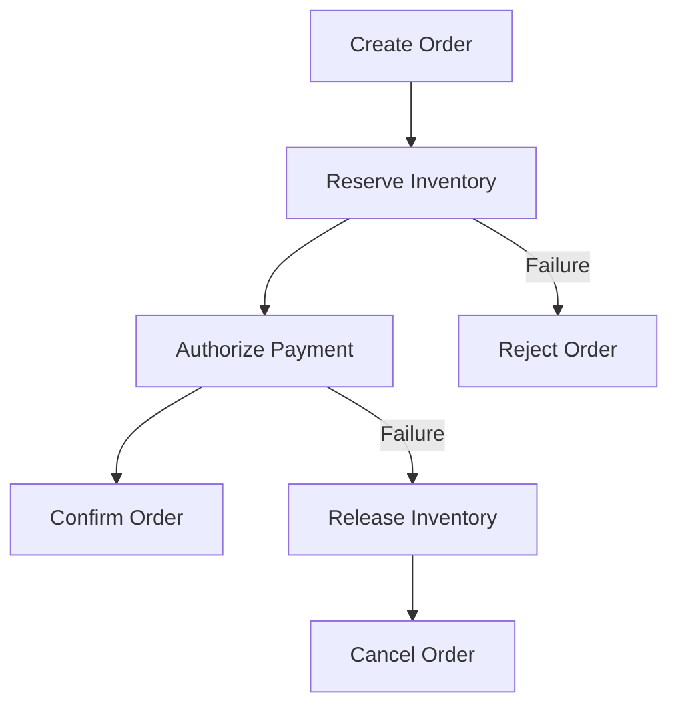
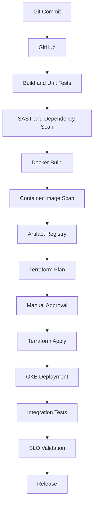

# Senior Cloud Architect / IC3 Interview Preparation – STAR-Based Q&A

For this role, I recommend preparing at an Architect + Hands-on Individual Contributor (IC3) level.

The interviewer will likely evaluate more than your knowledge of GCP services. They will want to understand whether you can independently make architecture decisions, solve complex technical problems, implement solutions, manage risks, and influence engineering teams.

Your CloudPulse AI POC is an excellent central case study for connecting these topics.

However, one important interview rule: distinguish between what you implemented in production, what you implemented in your POC, and what you are proposing as an architecture. Never present a simulated POC result as an actual enterprise production achievement.

## 1. What does an Architect / IC3 interviewer expect?

| Evaluation area | What the interviewer wants to see |
| --- | --- |
| Architecture | Ability to design scalable, resilient systems |
| Technical depth | Hands-on knowledge of GCP, Kubernetes, Java and Terraform |
| Problem-solving | Ability to troubleshoot complex production issues |
| Ownership | Ability to drive a solution independently |
| Engineering judgment | Ability to explain trade-offs |
| Security | Ability to design secure cloud platforms |
| Reliability | HA, DR, SLOs, incident management |
| Cost | Ability to optimize infrastructure spending |
| Leadership | Ability to influence developers and stakeholders |
| Innovation | Ability to introduce meaningful improvements |

### How to structure your STAR answers

## STAR interview framework

1. S – Situation
   Explain the business problem, existing architecture and technical challenges.
   Approximately 15–20% of your answer.
2. T – Task
   Explain your responsibility and what you were expected to achieve.
   Approximately 10–15%.
3. A – Action
   Explain your architecture decisions, implementation, troubleshooting and trade-offs.
   Approximately 45–55%. This is the most important part.
4. R – Result
   Explain measurable results, business impact and lessons learned.
   Approximately 15–20%.

My recommendation: Keep each main STAR answer between 2 and 3 minutes, and be ready for another 5 minutes of technical follow-up questions.

# 2. Core architecture and system design questions

## Q1. Tell me about a complex cloud architecture you designed.

High-priority questionWhat interviewer is testing: Architecture ownership, scalability, resilience, technical depth and business understanding.

### Sample STAR answer

S – Situation

In an enterprise application environment, traditional application architecture can create tight coupling between services. This makes independent scaling, application modernization and real-time business processing difficult.

T – Task

My objective was to design a cloud-native architecture on GCP that could support independent microservices, asynchronous processing, high availability, operational visibility and future scalability.

A – Action

I approached the design using domain-driven microservices and event-driven architecture.

- Designed Java Spring Boot services for independent business capabilities.
- Used GKE to orchestrate containerized workloads.
- Introduced Pub/Sub for asynchronous communication between services.
- Used Cloud SQL PostgreSQL for transactional workloads.
- Used BigQuery for analytical workloads.
- Used Cloud Storage for historical event archives.
- Designed Terraform modules for repeatable infrastructure provisioning.
- Incorporated IAM, encryption, network segmentation and centralized observability.
- Designed health checks, autoscaling, failure handling and recovery mechanisms.

One important decision was to separate transactional processing from analytical processing. I avoided making business transactions depend on synchronous analytical workloads.

R – Result

The architecture provided a foundation for independently scalable services, asynchronous processing and centralized operational visibility.

It also established a repeatable infrastructure deployment approach and created a foundation for predictive incident detection.

### Possible follow-up questions

- Why did you select Pub/Sub instead of Kafka?
- Why GKE instead of Cloud Run?
- How do you handle service failures?
- How do you prevent duplicate event processing?
- How would you scale to 10 million transactions per day?

## Q2. How would you design a real-time event-driven architecture on GCP?

Sample STAR answer

S – Situation

Consider an enterprise order-processing platform where orders, payments and inventory updates must be processed independently. Synchronous communication creates dependencies and can cause cascading failures.

T – Task

I needed to design an architecture that supported high-throughput event processing, independent services, reliable delivery and real-time analytics.

A – Action

I would design the following flow:

mermaid



My design considerations would include:

1. Publish domain events through Pub/Sub.
2. Use separate subscriptions for independent consumers.
3. Implement idempotent event consumers.
4. Use the transactional outbox pattern to avoid database/message dual-write inconsistencies.
5. Configure retries and dead-letter handling.
6. Use message ordering only where business requirements require it.
7. Implement schema versioning.
8. Use Dataflow for streaming transformations and BigQuery ingestion.
9. Monitor message backlog, processing latency and delivery failures.

I would also avoid assuming that Pub/Sub provides exactly-once business processing. Application-level idempotency is still essential.

R – Result

This architecture decouples business services, supports independent scaling and allows analytical processing without affecting the transactional path.

### Technical follow-up

| Question | Strong answer |
| --- | --- |
| Does Pub/Sub guarantee ordering? | Ordering keys can provide ordered delivery within supported scopes, with configuration considerations. |
| How do you handle duplicates? | Idempotency keys and processed-event tracking. |
| What if the consumer is unavailable? | Messages remain available for redelivery according to retention and subscription configuration. |
| How do you handle poison messages? | Retry policies, dead-letter topics and operational replay. |
| How do you avoid lost events? | Transactional outbox, publisher confirmation and reconciliation. |

# 3. GKE and Kubernetes interview questions

## Q3. How would you design a highly available GKE architecture?

S – Situation

An enterprise application needs to remain available even when individual Kubernetes nodes or an availability zone experience failures.

T – Task

Design a Kubernetes platform that supports workload availability, horizontal scaling, secure service communication and controlled deployments.

A – Action

I would use a regional GKE cluster distributed across multiple zones.

My architecture would include:

- Regional GKE control plane.
- Node pools distributed across zones.
- Horizontal Pod Autoscaler (HPA).
- Cluster autoscaling or Node Auto Provisioning where appropriate.
- Pod anti-affinity or topology spread constraints.
- Readiness and liveness probes.
- Pod Disruption Budgets.
- Resource requests and limits.
- Kubernetes Network Policies.
- Workload Identity Federation for GKE.
- Managed Prometheus and Cloud Monitoring.

For external traffic, I would use Google Cloud Load Balancing with the appropriate GKE Gateway or Ingress integration.

I would also separate workloads using namespaces and service accounts.

R – Result

This design improves workload resilience, provides horizontal scalability and reduces the risk of single-node or single-zone failures.

Architect-level point: A regional GKE cluster does not automatically make the entire application highly available. Database availability, external dependencies, storage, DNS, network connectivity and application state must also be addressed.

## Q4. How do you troubleshoot a Kubernetes application experiencing high latency?

S – Situation

An application deployed on GKE starts experiencing increased API latency, while users report intermittent timeouts.

T – Task

Identify the root cause, restore application performance and prevent recurrence.

A – Action

I would follow a structured troubleshooting approach.

1. Check Cloud Monitoring dashboards for CPU, memory and network utilization.
2. Check pod restarts, events and container logs.
3. Check HPA scaling behaviour.
4. Inspect CPU throttling and memory pressure.
5. Check database connection pools.
6. Examine downstream service latency.
7. Inspect Kubernetes service endpoints and network policies.
8. Review recent deployments and configuration changes.

Commands I would use:

bash

```bash
kubectl get pods -A

kubectl get events -A \
  --sort-by=.lastTimestamp

kubectl top nodes

kubectl top pods -A

kubectl describe pod <pod-name>

kubectl logs <pod-name> \
  --previous
```

I would use distributed tracing to determine whether latency originates in the API, database, messaging layer or another downstream dependency.

If CPU saturation is confirmed, I would evaluate HPA scaling. If database connections are exhausted, increasing replicas alone may worsen the problem.

R – Result

The objective is to restore service, identify the actual bottleneck, and implement a permanent corrective action rather than simply increasing infrastructure capacity.

### Additional GKE questions to prepare

| Interview question | Key points to cover |
| --- | --- |
| Deployment vs StatefulSet? | Stateless vs identity and persistent storage requirements |
| HPA vs VPA? | Horizontal replicas vs resource sizing |
| Liveness vs readiness? | Restart vs traffic eligibility |
| What is a PDB? | Availability during voluntary disruptions |
| How do you deploy without downtime? | Rolling deployments, probes, capacity and backward compatibility |
| How do you secure pods? | RBAC, Workload Identity, Network Policies, Pod Security |
| How do you handle cluster upgrades? | Version compatibility, maintenance windows, surge upgrades, workload disruption |
| How do you manage persistent workloads? | Persistent Volumes, StorageClasses, CSI drivers and backup strategy |

# 4. Java Spring Boot and microservices

## Q5. How do you design scalable Spring Boot microservices?

S – Situation

An enterprise monolithic application contains multiple business capabilities, and changes to one module can affect other modules.

T – Task

Modernize the application into independently deployable services while maintaining transaction integrity and operational consistency.

A – Action

I would use domain-driven design to identify service boundaries.

For example:

- Order Service.
- Payment Service.
- Inventory Service.
- Customer Service.
- Notification Service.

Each service would expose REST APIs for synchronous interactions and publish domain events for asynchronous communication.

I would implement:

- Spring Boot REST controllers.
- Service and repository layers.
- DTOs and validation.
- Centralized exception handling.
- Spring Data JPA.
- Resilience4j for circuit breakers and retries where appropriate.
- Micrometer metrics.
- OpenTelemetry distributed tracing.
- Structured JSON logging.
- OAuth 2.0 / JWT-based authentication.

For distributed transactions, I would prefer the Saga pattern rather than attempting to maintain a traditional ACID transaction across multiple independent databases.

R – Result

The resulting architecture supports independent deployments, independent scaling and better fault isolation.

It also enables teams to evolve individual business capabilities without requiring every application component to be released together.

## Q6. How do you handle distributed transactions in microservices?

Sample answer

I would first determine whether the business operation genuinely requires a single atomic transaction.

For transactions spanning multiple services, I would generally use the Saga pattern.

Example: An order requires inventory reservation and payment authorization.

mermaid



I would implement:

- Saga orchestration or choreography.
- Idempotent operations.
- Compensating transactions.
- Retry and timeout handling.
- Correlation IDs.
- Event persistence.
- Dead-letter processing.
- Reconciliation jobs.

I would also design for eventual consistency and ensure that the user-facing application communicates intermediate transaction states correctly.

Important follow-up: Explain why retries can create duplicate business operations and how idempotency prevents this.

# 5. Terraform and Infrastructure as Code

## Q7. How do you structure Terraform for an enterprise GCP environment?

Very important mandatory skillS – Situation

Managing cloud resources manually across development, staging and production environments creates configuration drift, inconsistent security policies and deployment risks.

T – Task

Establish a reusable and standardized Infrastructure as Code framework.

A – Action

I would structure Terraform using reusable modules and separate environment configurations.

Example:

text

```text
terraform/
├── modules/
│   ├── networking/
│   ├── gke/
│   ├── iam/
│   ├── pubsub/
│   ├── cloudsql/
│   ├── bigquery/
│   └── monitoring/
│
├── environments/
│   ├── dev/
│   ├── staging/
│   └── prod/
│
└── bootstrap/
```

I would implement:

1. Remote state in a secured GCS bucket.
2. State versioning and restricted access.
3. State locking using supported Terraform backend capabilities.
4. Separate service identities.
5. Reusable modules.
6. Environment-specific variables.
7. Resource labels and naming conventions.
8. Terraform validation and formatting.
9. Plan reviews before apply.
10. CI/CD-based infrastructure deployment.

I would also introduce policy checks for public IP exposure, encryption, IAM permissions and resource configuration.

R – Result

The organization gains consistent, repeatable infrastructure deployments, improved governance and reduced configuration drift.

### Follow-up questions

Q: How do you handle Terraform state locking?

For the GCS backend, Terraform supports state locking. I would use a properly secured, versioned bucket and ensure that state access is restricted.

Q: What if Terraform state is corrupted?

I would investigate the backend and state history, preserve a copy, validate the real infrastructure state, and recover carefully using the appropriate version or state recovery process.

Q: How do you prevent accidental resource deletion?

Use reviewed plans, deletion protection where supported, lifecycle safeguards, environment approvals and appropriate IAM restrictions.

Q: How do you manage secrets?

Use Secret Manager and controlled secret injection. Avoid plaintext secrets in Terraform variables, source control and state wherever possible.

Q: How do you detect infrastructure drift?

Run scheduled Terraform plans and compare actual infrastructure with declared configuration. Investigate unexpected changes before reconciling them.

## Q8. How would you manage Terraform across multiple GCP projects?

Sample answer

I would use a multi-project landing-zone strategy.

For example:

- Shared networking project.
- Development project.
- Staging project.
- Production project.
- Centralized security and logging project.

I would use reusable modules, environment-specific configurations and separate state backends or appropriately isolated state prefixes and access controls.

I would avoid sharing a single Terraform state file across unrelated environments because that increases operational risk.

I would also enforce organization-level policies and use centralized IAM governance.

# 6. GCP services – important technical questions

This section is particularly important because the job description explicitly lists several GCP products.

## Q9. Explain the differences between Compute Engine, GKE and Cloud Run.

| Service | Best suited for | Example |
| --- | --- | --- |
| Compute Engine | VM-based workloads and legacy applications | Legacy Java application |
| GKE | Containerized, complex distributed workloads | CloudPulse microservices |
| Cloud Run | Managed, stateless containerized services | Event-processing API |

Interview answer:

I select services based on operational complexity, scaling requirements, runtime control and workload characteristics.

For a complex microservices platform requiring Kubernetes-level orchestration, custom scheduling, sidecars or specialized workload management, I would consider GKE.

For stateless APIs and event-driven workloads where infrastructure management should be minimized, I would consider Cloud Run.

For applications that require VM-level control, specialized operating systems or legacy compatibility, I would use Compute Engine.

I wouldn't choose GKE simply because an application is containerized.

## Q10. How do you select between Cloud SQL and BigQuery?

Answer:

Cloud SQL is a transactional relational database service. BigQuery is a serverless analytical data warehouse.

| Requirement | Choice |
| --- | --- |
| Customer transaction | Cloud SQL |
| Order persistence | Cloud SQL |
| Relational queries | Cloud SQL |
| Historical event analysis | BigQuery |
| Large analytical queries | BigQuery |
| Operational reporting | Often BigQuery |

In CloudPulse AI, I would persist business transactions in Cloud SQL and send event data into BigQuery for operational analytics.

I would avoid using BigQuery as the primary transactional database.

## Q11. Explain how you use Cloud Storage.

Answer:

I use Cloud Storage for object-based storage rather than transactional database operations.

Typical use cases include:

- Application documents.
- Historical event archives.
- Data lake storage.
- Backup exports.
- Analytics input files.
- Dataflow pipeline staging and temporary files.

For enterprise implementations, I consider:

- Bucket-level IAM.
- Uniform bucket-level access.
- Retention policies.
- Object versioning.
- Lifecycle rules.
- Encryption.
- Regional or dual-region storage.
- Recovery requirements.

## Q12. When would you use Cloud Functions?

Answer:

I would use Cloud Functions, now generally called Cloud Run functions in current Google Cloud documentation, for event-triggered or lightweight serverless processing.

Examples:

- Trigger processing when an object is uploaded to Cloud Storage.
- Process Pub/Sub events.
- Trigger notification workflows.
- Perform lightweight data validation.
- Execute simple event-driven integrations.

For complex business logic, I would prefer a properly structured service rather than creating many tightly coupled functions.

## Q13. How do you monitor applications on GCP?

Answer:

I would implement a three-layer observability approach.

1. Metrics: Cloud Monitoring and Managed Service for Prometheus.
2. Logs: Cloud Logging with structured JSON logging.
3. Traces: OpenTelemetry and Cloud Trace.

I would establish service-level indicators such as:

- Request success rate.
- API latency.
- Error rate.
- Throughput.
- Queue backlog.
- Database connection utilization.

I would define SLOs and alert on actionable conditions rather than alerting on every infrastructure metric.

For example, I might define a 99.9% availability objective for a critical API, subject to business requirements and cost constraints.

# 7. Cloud networking and load balancing

## Q14. Explain how you would design GCP networking for an enterprise application.

S – Situation

An enterprise application needs secure communication between application workloads, databases and external systems.

T – Task

Design a scalable and secure network architecture with controlled inbound and outbound access.

A – Action

I would use:

- Custom-mode VPC.
- Regional subnets.
- Separate IP ranges for GKE Pods and Services.
- Private Google Access where required.
- Cloud NAT for controlled outbound connectivity.
- Firewall rules.
- Private connectivity to databases.
- Cloud DNS.
- Appropriate load balancers.
- VPC Flow Logs and network monitoring.

For GKE, I would use VPC-native clusters and plan secondary IP ranges carefully.

I would avoid overlapping CIDR ranges, especially where hybrid connectivity is involved.

R – Result

The network provides controlled connectivity, workload isolation, predictable IP allocation and a foundation for enterprise hybrid-cloud integration.

## Q15. Explain GCP load balancing options.

| Load balancer | Typical use |
| --- | --- |
| Global external Application Load Balancer | Internet-facing global HTTP(S) applications |
| Regional external Application Load Balancer | Regional external HTTP(S) traffic |
| Internal Application Load Balancer | Internal HTTP(S) applications |
| Network Load Balancer | TCP/UDP and other supported network traffic patterns |

My selection would depend on whether the application requires global or regional access, external or internal traffic, HTTP routing, or transport-level load balancing.

I would also consider health checks, backend capacity, TLS termination, Cloud Armor and session-affinity requirements.

## Q16. How does DNS-based service discovery work in Kubernetes?

Answer:

Kubernetes provides built-in service discovery through cluster DNS.

A service can be accessed using a DNS name such as:

text

```text
inventory-service.default.svc.cluster.local
```

This allows applications to discover services without depending on individual pod IP addresses.

For external service discovery, I would use Cloud DNS and an appropriate traffic-routing strategy.

I would distinguish between Kubernetes internal DNS and enterprise DNS-based routing across clusters or regions.

# 8. Security, governance and compliance

## Q17. How would you secure a GCP application architecture?

High-priority questionS – Situation

An enterprise platform contains customer information, transactional data and multiple application workloads. Different services require different levels of access.

T – Task

Establish an enterprise security architecture that protects data and limits unauthorized access.

A – Action

I would implement security in layers.

Identity

- Least-privilege IAM.
- Dedicated service accounts.
- Workload Identity Federation.
- No long-lived service account keys.
- Centralized access governance.

Network

- Private GKE nodes where appropriate.
- Network segmentation.
- Firewall restrictions.
- Cloud Armor for supported internet-facing applications.
- Private database connectivity.

Data

- Encryption at rest and in transit.
- Cloud KMS where customer-managed keys are required.
- Secret Manager.
- Data classification.
- Retention and deletion policies.

Application

- OAuth 2.0 / OIDC.
- JWT validation.
- Input validation.
- Dependency scanning.
- Container scanning.
- Secure API design.

Monitoring

- Cloud Audit Logs.
- Security event monitoring.
- IAM change tracking.
- Centralized logging.

R – Result

The architecture reduces the attack surface, provides traceability and supports enterprise security governance.

## Q18. Explain the difference between IAM roles and service accounts.

Answer:

A service account represents a workload identity.

An IAM role is a collection of permissions.

For example, the Order Service can run using a dedicated service account with only the permissions required to publish messages to its Pub/Sub topic and access its required secrets.

I would avoid giving the application broad project-level Editor permissions.

For GKE workloads, I would use Workload Identity Federation for GKE to associate Kubernetes workloads with Google Cloud IAM identities.

## Q19. What is the difference between Google-managed encryption keys and CMEK?

Answer:

Google-managed encryption keys are managed by Google Cloud.

Customer-managed encryption keys use Cloud KMS, allowing the customer to manage key lifecycle, access policies and rotation requirements.

I would select CMEK when regulatory, contractual or organizational security requirements justify additional key control.

I would also evaluate operational complexity, key availability and recovery implications.

# 9. AI-assisted predictive analytics and automated remediation

This is an area where you can differentiate yourself from candidates who only know traditional cloud infrastructure.

## Q20. How would you build an AI-assisted predictive monitoring platform?

S – Situation

Traditional monitoring typically detects issues after metrics cross predefined thresholds. This can delay incident identification and increase business impact.

T – Task

Design an intelligent platform that identifies abnormal patterns, predicts operational risks and recommends corrective action.

A – Action

I would build a telemetry pipeline using:

1. Cloud Monitoring for infrastructure metrics.
2. Cloud Logging for application logs.
3. Pub/Sub for event distribution.
4. BigQuery for historical telemetry.
5. Statistical anomaly detection for initial prediction.
6. Vertex AI for optional natural-language incident analysis.

I would start with explainable statistical approaches such as moving averages, EWMA and standard-deviation-based anomaly detection.

For example:

- CPU increases rapidly.
- Request latency increases.
- Database connection utilization approaches saturation.
- Error rates increase.

The system combines these indicators to calculate risk and identify possible service degradation.

I would then use an AI assistant to summarize the evidence and recommend remediation.

I would not let an LLM directly control infrastructure.

R – Result

The platform provides earlier detection of abnormal conditions, better incident context and more consistent operational recommendations.

It also creates an opportunity to move from reactive monitoring toward predictive operations.

## Q21. How would you implement automated incident remediation?

Sample STAR answer

S – Situation

An application running on Kubernetes experiences resource saturation, causing increased latency and service degradation.

T – Task

Reduce recovery time and minimize manual operational intervention.

A – Action

I would implement a controlled remediation workflow.

- Detect abnormal telemetry.
- Correlate metrics with application logs.
- Identify the affected workload.
- Generate a remediation recommendation.
- Validate the action against predefined policies.
- Require operator approval for high-impact changes.
- Execute a predefined Kubernetes action.
- Monitor service recovery.
- Record the action and outcome.

For example, scaling the Order Service from three to five replicas may be an approved response to CPU saturation, provided the database and downstream dependencies have sufficient capacity.

I would also introduce cooldown periods, action limits and rollback mechanisms to prevent remediation loops.

R – Result

This approach reduces repetitive manual intervention while preserving operational control and auditability.

## Q22. Can AI predict infrastructure failures accurately?

Answer:

AI can identify anomalies and forecast certain operational risks, but prediction accuracy depends on historical data quality, signal selection and workload patterns.

I would distinguish three capabilities:

- Anomaly detection: Identifies unusual behaviour.
- Forecasting: Estimates future metric trends.
- Failure prediction: Estimates the likelihood of a defined failure event.

I would measure model precision, recall, false-positive rates and detection lead time.

I would never present a risk score as a guaranteed failure probability unless the model has been calibrated and validated for that interpretation.

# 10. High availability and disaster recovery

## Q23. How would you design a highly available and disaster-recovery architecture on GCP?

Critical architecture questionS – Situation

An enterprise application supports critical business transactions and must remain available during infrastructure failures or regional outages.

T – Task

Design an architecture that supports high availability, business continuity and predictable recovery.

A – Action

I would start by defining the business RTO and RPO requirements.

Then I would design:

Application layer

- Regional GKE cluster across multiple zones.
- Multiple replicas.
- Pod disruption budgets.
- Autoscaling.
- Health checks.

Database layer

- Cloud SQL HA configuration.
- Automated backups.
- Point-in-time recovery where supported.
- Cross-region backup or replication strategy according to RPO.

Messaging layer

- Pub/Sub retention.
- Retry and dead-letter handling.
- Idempotent consumers.
- Event replay procedures.

Storage layer

- Appropriate Cloud Storage location.
- Object versioning and retention.
- Backup and recovery procedures.

Traffic layer

- Load balancing.
- Health-based traffic routing.
- Cloud DNS failover where appropriate.

For regional DR, I would maintain a secondary recovery environment and test the failover process.

R – Result

The architecture provides resilience against individual infrastructure failures and establishes a documented recovery strategy for regional disruptions.

### RTO vs RPO

| Term | Meaning | Example |
| --- | --- | --- |
| RTO | Maximum acceptable recovery time | 30 minutes |
| RPO | Maximum acceptable data loss measured in time | 5 minutes |

Remember:

- High availability is not disaster recovery.
- Multi-zone is not multi-region.
- Backups are not a complete DR strategy.
- DR must be tested, not just documented.

## Q24. What are the different disaster recovery strategies?

Answer:

I would evaluate four common strategies.

| Strategy | Cost | Recovery characteristics |
| --- | --- | --- |
| Backup and restore | Lowest | Slow recovery |
| Pilot light | Low to medium | Core services maintained, scaled during recovery |
| Warm standby | Medium to high | Partially operational secondary environment |
| Active-active | Highest | Both environments serve traffic |

I would select the strategy based on business criticality, RTO, RPO and budget.

For a financial transaction platform, warm standby or active-active may be justified. For a non-critical internal application, backup and restore may be sufficient.

## Q25. How do you test a disaster recovery plan?

Sample answer:

I would conduct controlled recovery exercises.

1. Define the failure scenario.
2. Confirm backups and replication health.
3. Simulate primary environment unavailability.
4. Execute the recovery runbook.
5. Restore or redirect application services.
6. Validate database consistency.
7. Validate business transactions.
8. Measure actual RTO and RPO.
9. Record gaps and corrective actions.

I would also test failback, because returning to the primary environment can be more complicated than failing over.

# 11. DevOps, CI/CD and automation

## Q26. Explain how you would build a CI/CD pipeline for GCP.

S – Situation

Manual deployments introduce inconsistencies, operational errors and delays in releasing application changes.

T – Task

Implement an automated delivery pipeline with security checks and controlled production releases.

A – Action

I would implement the following pipeline:

mermaid



I would use GitHub Actions or Cloud Build depending on the organization's delivery standards.

For infrastructure changes, I would separate Terraform plan and apply.

For application deployment, I would use immutable image tags and controlled rollout strategies.

I would also introduce rollback and post-deployment validation.

R – Result

The delivery process becomes repeatable, auditable and less dependent on manual intervention.

## Q27. Jenkins vs GitHub Actions vs Cloud Build – how do you choose?

| Tool | Strength |
| --- | --- |
| Jenkins | Flexible, mature, self-managed CI/CD |
| GitHub Actions | Native GitHub integration and workflow automation |
| Cloud Build | Managed GCP-native build and deployment integration |

Interview answer:

I wouldn't select a CI/CD tool based solely on popularity.

I would evaluate existing organizational investments, developer experience, security, network access, governance and operational overhead.

For a GCP-centric architecture, Cloud Build is a strong choice. If the organization uses GitHub extensively, GitHub Actions can provide a convenient source-driven workflow. Jenkins remains useful in enterprises with existing complex pipelines and integrations.

## Q28. How would you implement zero-downtime deployments?

Answer:

I would use rolling deployments with:

- Readiness probes.
- Appropriate replica counts.
- Deployment surge and unavailable settings.
- Graceful shutdown.
- Backward-compatible API changes.
- Database migration compatibility.
- Connection draining where appropriate.
- Health-based rollout validation.

For more complex release requirements, I would consider blue-green or canary deployments.

I would never assume that Kubernetes rolling updates alone guarantee zero downtime. Application readiness, database compatibility and traffic management matter equally.

# 12. Cloud migration and enterprise modernization

## Q29. How would you migrate a legacy on-premises application to GCP?

Preferred skill – high priorityS – Situation

An enterprise operates a legacy application on-premises with tightly coupled modules, a stateful database and manual deployment processes.

The organization wants to modernize the platform while minimizing disruption to business operations.

T – Task

Develop a migration strategy that balances business continuity, modernization, cost and operational risk.

A – Action

I would first conduct application discovery.

I would assess:

- Application dependencies.
- Database dependencies.
- Network connectivity.
- Data volumes.
- Batch processing.
- Performance requirements.
- Security and compliance.
- Licensing constraints.

Then I would classify workloads using the 6 Rs:

| Strategy | Meaning |
| --- | --- |
| Rehost | Move with minimal changes |
| Replatform | Make targeted platform improvements |
| Refactor | Modify application architecture |
| Repurchase | Replace with SaaS or another product |
| Retain | Keep temporarily |
| Retire | Decommission |

I would generally avoid rewriting the entire legacy system in one migration.

I would introduce a phased approach using the Strangler Fig pattern.

For stateful workloads, I would assess database migration compatibility, replication, consistency, cutover procedures and rollback.

I would also establish a hybrid connectivity strategy using Cloud VPN or Cloud Interconnect where required.

R – Result

This approach reduces migration risk, allows business capabilities to move incrementally and establishes a roadmap toward cloud-native modernization.

## Q30. How would you migrate a large stateful application to GCP?

Answer:

I would begin with an application and data dependency assessment.

Then:

1. Identify stateful components.
2. Evaluate database compatibility.
3. Select the appropriate migration approach.
4. Establish secure network connectivity.
5. Perform initial data migration.
6. Set up replication or change-data capture where supported.
7. Validate data consistency.
8. Run performance testing.
9. Execute controlled cutover.
10. Validate transactions and maintain a rollback strategy.

For database migration, I would evaluate Database Migration Service where the source and target are supported.

I would also assess whether the application is suitable for Cloud SQL, a self-managed database on Compute Engine or another managed database service.

## Q31. How do you manage a monolith-to-microservices transformation?

Answer:

I would not split the monolith based only on technical modules.

I would identify business domains and bounded contexts first.

Then I would:

- Identify independently deployable capabilities.
- Define service boundaries.
- Establish API contracts.
- Introduce event-driven integration.
- Extract services incrementally.
- Maintain compatibility with the monolith.
- Introduce observability and service ownership.
- Decommission legacy modules after successful transition.

I would use the Strangler Fig pattern and avoid creating distributed monoliths.

# 13. Redis, real-time data and performance optimization

## Q32. When would you use Redis or Valkey in a cloud-native architecture?

S – Situation

An application experiences high database read traffic and repeated requests for the same data.

T – Task

Improve response times and reduce database pressure.

A – Action

I would introduce Redis or Valkey as a caching layer.

Typical use cases:

- Frequently accessed reference data.
- Session-related state where appropriate.
- Rate-limiting counters.
- Temporary workflow state.
- Frequently requested metadata.

I would implement a cache-aside strategy.

The application first checks the cache. If the data is unavailable, it retrieves it from the database and updates the cache.

I would carefully define:

- TTL.
- Eviction policy.
- Cache invalidation.
- Serialization.
- Hot-key management.
- Cache stampede protection.
- Memory limits.

I would avoid treating the cache as the source of truth for critical business transactions.

R – Result

Caching can reduce database load and improve application latency, provided consistency and invalidation are properly managed.

## Q33. How would you optimize an application with increasing cloud costs?

Sample STAR answer

S – Situation

An application experiences increasing traffic, infrastructure consumption and operational expenses.

T – Task

Improve cost efficiency without compromising service availability or performance.

A – Action

I would analyze cost at both infrastructure and application levels.

- Review GCP billing reports and exports.
- Analyze GKE resource requests and actual usage.
- Identify idle workloads.
- Optimize autoscaling.
- Evaluate machine types.
- Review storage lifecycle policies.
- Analyze database utilization.
- Review network egress.
- Optimize BigQuery query patterns.
- Evaluate caching opportunities.

I would also introduce resource labels and team-level cost allocation.

I would compare cost per transaction rather than simply looking at total monthly spending.

R – Result

The goal is to improve cost efficiency while maintaining agreed SLOs.

For interview purposes, quantify your real result if you have measured one. For example, report the percentage reduction in cost per transaction only if supported by actual billing and workload data.

## Q34. How would you handle a real-time data ingestion architecture?

Answer:

I would select the ingestion pattern based on throughput, latency, transformation complexity and delivery requirements.

For GCP:

- Pub/Sub for event ingestion.
- Dataflow for streaming transformations.
- BigQuery for analytical storage.
- Cloud Storage for raw event archives.

I would design for:

- Schema evolution.
- Late-arriving events.
- Duplicate records.
- Event-time processing.
- Dead-letter handling.
- Replay capability.
- Monitoring of throughput and backlog.

I would also distinguish between event ingestion latency and analytical query latency.

# 14. Observability and production incident management

## Q35. How do you establish observability for microservices?

Answer:

I use the three pillars of observability.

Metrics

- Request rate.
- Error rate.
- Latency.
- CPU.
- Memory.
- Database connections.
- Message backlog.

Logs

- Structured JSON.
- Correlation ID.
- Trace ID.
- Service name.
- Environment.
- Severity.
- Error context.

Traces

- End-to-end request flow.
- Downstream latency.
- Database spans.
- Pub/Sub processing spans.

I would use OpenTelemetry instrumentation and integrate with Google Cloud observability tools.

I would define SLIs, SLOs and alerting policies around customer impact.

## Q36. Describe how you would handle a critical production incident.

S – Situation

A critical business API starts returning elevated 5xx errors and transaction processing slows down.

T – Task

Restore service, identify root cause and minimize business impact.

A – Action

My approach would be:

1. Establish incident severity.
2. Identify affected services and users.
3. Check recent deployments and configuration changes.
4. Review metrics, logs and distributed traces.
5. Identify the dependency causing failure.
6. Implement a safe mitigation.
7. Communicate status to stakeholders.
8. Validate service recovery.
9. Conduct a root-cause analysis.
10. Implement preventive actions.

I would prioritize service restoration before performing extensive root-cause analysis if the incident is actively affecting customers.

R – Result

The desired result is controlled incident resolution, reduced business impact and documented preventive measures.

I would measure MTTR, recurrence rate and SLO impact.

# 15. Architecture leadership and behavioral questions

At IC3, being technically strong is not enough. Interviewers also want to understand how you make decisions and work with other teams.

## Q37. Tell me about a time you disagreed with another architect.

S – Situation

During an architecture review, one team proposed a centralized synchronous communication approach between multiple services.

T – Task

My responsibility was to evaluate the design against availability, scalability and operational requirements.

A – Action

I documented the dependency risks and compared synchronous and asynchronous communication patterns.

I presented an alternative architecture using Pub/Sub for independent event processing while retaining synchronous REST calls for operations requiring immediate responses.

I also discussed the operational implications, including eventual consistency, retries and message duplication.

Rather than making the decision based on personal preference, I presented architecture trade-offs and measurable requirements.

R – Result

The teams could make an informed architectural decision based on business requirements and operational risks.

Adapt this example to a real disagreement you have experienced.

## Q38. How do you influence teams without direct authority?

Answer using STAR:

S: Multiple engineering teams follow inconsistent deployment and security practices.

T: Establish a common architecture and engineering standard.

A: I would introduce reference architectures, reusable Terraform modules, CI/CD templates, security guidelines and architecture reviews. I would involve teams in the design rather than simply imposing standards.

R: This creates consistency, improves adoption and reduces repeated engineering effort.

## Q39. How do you handle technical debt?

Answer:

I classify technical debt based on business impact, security risk, operational risk and cost.

I prioritize issues that create reliability or security concerns.

For example, if a legacy application has tightly coupled database access, I would first improve observability and establish safe interfaces before attempting a full architectural refactor.

I would track technical debt as part of the engineering roadmap rather than treating it as an unrelated activity.

## Q40. How do you choose between an innovative architecture and a proven architecture?

Answer:

Innovation should solve a measurable problem.

I evaluate:

- Business value.
- Operational complexity.
- Security.
- Reliability.
- Cost.
- Team capabilities.
- Long-term maintainability.

I prefer controlled experimentation through a POC, followed by measurable validation.

I would not introduce AI, Kubernetes or distributed event processing simply because they are modern technologies.

# 16. Most important IC3 architecture scenario questions

These are the questions where interviewers may give you a problem statement and expect you to design a solution on a whiteboard.

Practice answering each without looking at notes.

| # | Scenario question | What to cover |
| --- | --- | --- |
| 1 | Design an architecture handling 10 million orders per day. | GKE, Pub/Sub, database partitioning, autoscaling |
| 2 | How would you process 100,000 events per second? | Pub/Sub throughput, partitioning, Dataflow, backpressure |
| 3 | What happens if Pub/Sub consumers stop working? | Backlog, retries, DLQ, replay |
| 4 | How would you avoid duplicate payments? | Idempotency, transactional outbox, reconciliation |
| 5 | Design a multi-region GCP application. | Regional architecture, data replication, failover |
| 6 | How would you migrate 5 TB of database data? | DMS where supported, CDC, validation, cutover |
| 7 | GKE pods keep restarting. How do you investigate? | OOMKilled, probes, logs, resource limits |
| 8 | Cloud SQL reaches maximum connections. What do you do? | Pooling, connection limits, query optimization |
| 9 | How do you secure communication between microservices? | Workload Identity, mTLS where required, network policies |
| 10 | Terraform wants to destroy production resources. What do you do? | Plan review, state validation, lifecycle protection |
| 11 | How do you optimize a GKE cluster costing too much? | Requests, limits, autoscaling, node pools |
| 12 | How would you introduce AI into cloud operations? | Telemetry, anomaly detection, evidence-based recommendations |
| 13 | How would you modernize a stateful monolith? | Domain boundaries, strangler pattern, migration strategy |
| 14 | How would you design a zero-downtime migration? | Replication, compatibility, cutover, rollback |
| 15 | How do you handle an outage affecting an entire GCP region? | DR, RTO/RPO, secondary region, data recovery |

## 17. Rapid-fire GCP technical questions

These are worth memorizing as short, technically accurate answers.

| Question | Answer |
| --- | --- |
| What is a VPC? | A logically isolated network for GCP resources. |
| What is Shared VPC? | Centralized network management across multiple projects. |
| What is Cloud NAT? | Provides outbound internet connectivity for private resources without assigning external IPs to them. |
| What is Private Google Access? | Allows eligible resources without external IPs to access supported Google APIs and services. |
| What is Workload Identity Federation for GKE? | Allows Kubernetes workloads to authenticate to Google Cloud using federated identities. |
| What is Pub/Sub? | A managed asynchronous messaging and event distribution service. |
| What is Dataflow? | A managed data processing service based on Apache Beam. |
| What is BigQuery? | A serverless analytical data warehouse. |
| What is Cloud SQL HA? | A managed database HA configuration using primary and standby resources across zones. |
| What is Cloud Armor? | A security service providing application-layer protection and traffic controls. |
| What is Cloud Logging? | Centralized collection, storage and analysis of logs. |
| What is Cloud Monitoring? | Infrastructure and application metrics, dashboards, alerting and monitoring. |
| What is Artifact Registry? | Managed storage for container images and other build artifacts. |
| What is GKE Autopilot? | A GKE operating mode where Google manages more of the cluster infrastructure and node operations. |
| What is a dead-letter topic? | A destination for messages that cannot be successfully processed after configured delivery attempts. |
| What is the transactional outbox pattern? | A pattern that reliably coordinates database changes and event publication. |

# 18. Your 90-second interview introduction

This is how I would position you for the Senior Cloud Architect / IC3 role.

Writing

I approach cloud architecture from both an architectural and hands-on engineering perspective.

My focus is on designing scalable, secure and resilient cloud-native platforms, particularly using Google Cloud Platform.

My technical areas include GCP architecture, GKE and Kubernetes, Java Spring Boot microservices, event-driven architecture, Terraform-based infrastructure automation, CI/CD and cloud security.

I focus on designing systems that are not only scalable but also operationally reliable, cost-efficient and secure.

For example, in my CloudPulse AI architecture initiative, I am building an intelligent cloud operations platform that combines event-driven microservices, Pub/Sub, real-time analytics, predictive anomaly detection and controlled automated remediation.

I am particularly interested in solving complex architectural problems involving application modernization, distributed systems, high availability, disaster recovery and operational automation.

My approach is to understand business requirements first, evaluate architectural trade-offs, establish engineering standards, and then work hands-on with development and operations teams to deliver the solution.

I believe a successful cloud architect should be able to explain the architecture, implement critical components, troubleshoot production issues and take ownership of the technical outcome.

Only use statements about experience and implementation that accurately reflect your background. Describe CloudPulse AI as a POC or architecture initiative until you have actually completed its implementation.

# 19. How to answer architecture questions at IC3 level

A common mistake is jumping directly into technology.

For example, when asked:

"Design a real-time order processing system."

Don't immediately say:

"I will use GKE, Pub/Sub, BigQuery and Cloud SQL."

Instead, structure your answer like this:

## Your architecture answer framework

1. Clarify requirements
    - Expected throughput?
    - Latency requirements?
    - Availability target?
    - Data consistency requirements?
    - RTO and RPO?
2. Identify workloads
    - Transactional.
    - Analytical.
    - Event-driven.
    - Stateful.
    - Stateless.
3. Draw the architecture
   Show the request flow, data flow, security boundaries and dependencies.
4. Explain technology selection
   Explain why you chose GKE, Pub/Sub, Cloud SQL and BigQuery, including alternatives.
5. Explain failure handling
   Discuss retries, idempotency, autoscaling, HA and DR.
6. Discuss operational aspects
   Monitoring, logging, security, governance and FinOps.
7. Explain trade-offs
   Identify cost, complexity, performance and consistency trade-offs.

This structure helps you demonstrate architectural maturity rather than simply listing GCP services.

# 20. Seven-day interview preparation schedule

I recommend preparing in this order.

## 7-day preparation plan

1. Day 1 – GCP Architecture
   Compute Engine, GKE, Cloud SQL, BigQuery, Pub/Sub, Cloud Storage, Cloud Functions, networking.
2. Day 2 – Kubernetes and Java
   GKE architecture, Kubernetes troubleshooting, Spring Boot, microservices, distributed transactions.
3. Day 3 – Terraform and DevOps
   Terraform modules, state, IAM, GitHub Actions, Jenkins, Cloud Build.
4. Day 4 – HA, DR and Security
   Multi-zone, multi-region, RTO/RPO, IAM, KMS, networking, compliance.
5. Day 5 – Event-driven and AI architecture
   Pub/Sub, Dataflow, BigQuery, anomaly detection, AI incident analysis, automated remediation.
6. Day 6 – Migration and FinOps
   Legacy modernization, database migration, Redis, DNS, cost optimization.
7. Day 7 – Mock interview
   STAR answers, architecture whiteboarding, troubleshooting scenarios and behavioral questions.

# 21. Let's conduct a realistic IC3 mock interview

I suggest we go beyond memorizing 40 answers. I'll act as the interviewer and evaluate your answers like a technical architecture panel.

For each question, I'll score you on:

- Architecture and design: 25 points.
- Technical depth: 25 points.
- Problem-solving: 20 points.
- Trade-offs and decision-making: 15 points.
- Communication and ownership: 15 points.

# IC3 Mock Interview – Round 1

Architecture

QUESTION 01 · SYSTEM DESIGN · 100 POINTS

Design a real-time enterprise order processing platform on GCP.

Your system must support:

- 10 million orders per day.
- Sudden traffic spikes of 10x.
- Independent microservices.
- Real-time order and inventory updates.
- 99.99% availability target.
- Disaster recovery across regions.
- Secure customer transaction processing.
- Real-time operational monitoring.

Interviewer asks:

"Walk me through your end-to-end architecture. Which GCP services would you select, how would services communicate, how would you handle failures, and how would you ensure scalability and availability?"

Type your answer as if you are speaking to the interview panel.

Submit answer for evaluation

My recommendation: Start with this mock interview instead of trying to memorize every answer. At IC3 level, the ability to reason through unfamiliar architecture problems is often more important than recalling definitions.